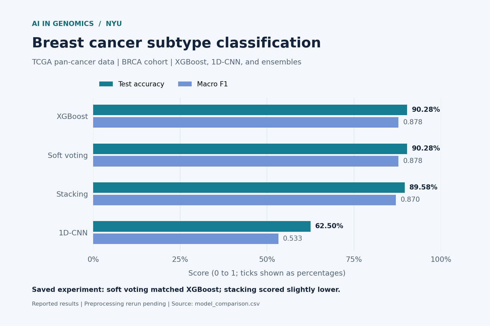
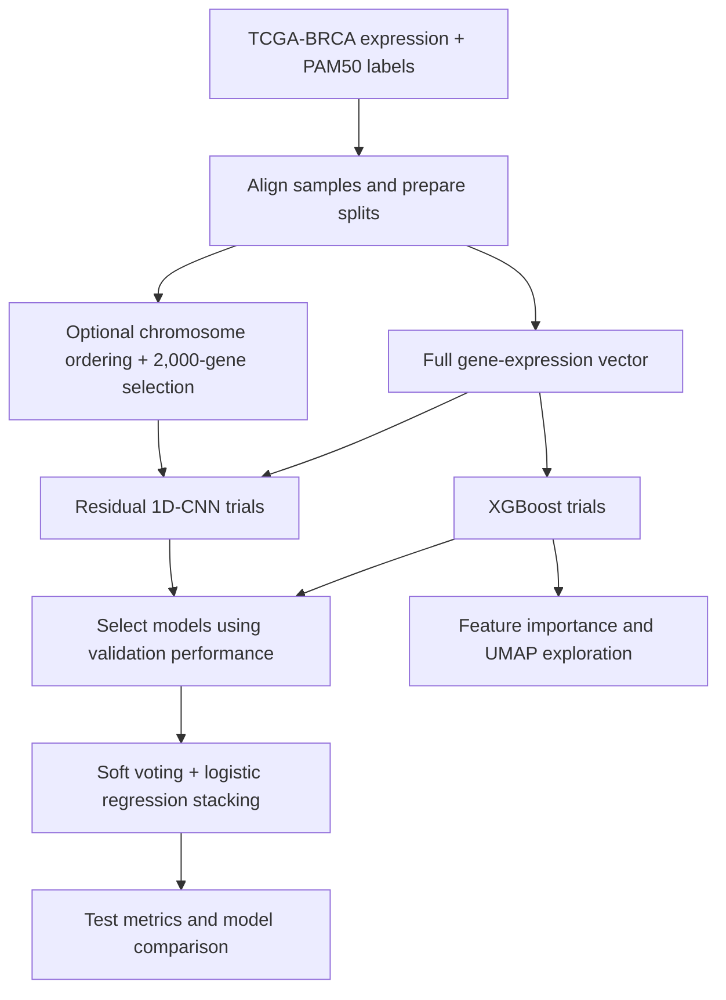

<div align="center">

# Breast Cancer Subtype Classification

### XGBoost, a residual 1D-CNN, and ensembles on TCGA gene expression

**AI in Genomics · NYU · Python · XGBoost · PyTorch · GPU Computing**

[Results](#results) · [Submitted report](AI_Genomics_Final_Report_v3.pdf) · [Code](code/) · [Run the pipeline](#running-the-pipeline)

</div>



## The question

Gene-expression data is wide: thousands of features, but comparatively few labeled samples. This experiment tests how different models handle that challenge and whether combining model families improves the prediction.

This project compares **gradient-boosted trees**, a **residual convolutional neural network**, and **two ensembles** for predicting **PAM50 breast cancer subtypes**. The source is **TCGA pan-cancer data**, accessed through UCSC Xena; this project uses the **BRCA cohort**. “Pan-cancer” describes the data source, while the prediction task is breast cancer subtype classification.

The submitted experiment found that **XGBoost was the strongest model, and adding the CNN did not improve the reported test results**. A follow-up experiment explored whether chromosomal gene ordering could give the CNN more useful local structure.

## At a glance

| | Submitted experiment |
| :--- | :--- |
| **Data source / cohort** | TCGA pan-cancer data via UCSC Xena / breast invasive carcinoma (BRCA) |
| **Labeled samples** | 956 |
| **Input features** | 19,847 genes after variance filtering |
| **Prediction target** | Luminal A, Luminal B, Basal-like, HER2-enriched, Normal-like |
| **Split counts** | 690 training / 122 validation / 144 test samples |
| **Compute** | NYU HPC Burst cluster, NVIDIA A100 GPU |
| **Search** | 60 XGBoost configurations; a 10-configuration CNN sweep, with a gene-ordering follow-up |

These details follow the submitted [v3 report](AI_Genomics_Final_Report_v3.pdf), dated May 2026. Current grid generators have different CNN trial settings; see the reproducibility notes below.

## Results

The four-model comparison below matches the submitted report and [`plots/model_comparison.csv`](plots/model_comparison.csv). Values are rounded for display.

| Model | Test accuracy | Macro F1 |
| :--- | ---: | ---: |
| **XGBoost (best trial)** | **90.28%** | **0.878** |
| Soft voting ensemble | 90.28% | 0.878 |
| Stacking ensemble | 89.58% | 0.870 |
| 1D-CNN (best trial) | 62.50% | 0.533 |

> **How to read these numbers:** These are the original experiment’s reported results, not a new rerun. The current preprocessing fits scaling and variance filtering before splitting, which needs correction. Treat the scores as preliminary until the checked-in pipeline has been reconciled with the report and rerun.

### What I learned

- **Model choice matters.** XGBoost outperformed the CNN on this cohort and setup. This is evidence about this experiment, rather than a general ranking of trees and neural networks.
- **An ensemble needs useful complementary predictions.** The report records a soft-voting weight of 1.0 for XGBoost, assigning zero weight to the CNN. Stacking scored slightly lower.
- **Feature order is a hypothesis worth testing.** The follow-up sorted genes by chromosomal position and retained 2,000 genes. The reported CNN performance gap remained.
- **Overall accuracy is only part of the picture.** Per-subtype F1 highlights uneven performance across classes, especially the smaller HER2-enriched subtype.

The Random Forest baseline reached **83.6% validation accuracy** in the report. It is kept separate from the test comparison because it was evaluated on a different split.

## How it works



**XGBoost:** multiclass probability predictions, regularization, sampled hyperparameter search, and early stopping.

**1D-CNN:** a convolutional stem, residual blocks, global average pooling, and a classification head. Training uses dropout, label smoothing, AdamW, cosine learning-rate scheduling, early stopping, and gradient clipping.

**Ensembles:** validation-tuned probability averaging and a logistic regression meta-learner trained on validation predictions.

The report describes sequential GPU trials on NYU HPC. Individual trial scripts are included; scheduler submission files are not included in this checkout.

## Explore the analysis

| Artifact | What it shows |
| :--- | :--- |
| [XGBoost sweep](plots/sweep_summary.png) | Validation performance across hyperparameter configurations |
| [Per-subtype F1](plots/per_class_f1.png) | Differences in model performance across subtypes |
| [Feature importance](plots/feature_importance.png) | Genes ranked by the trained tree model |
| [Feature rankings CSV](plots/feature_importances.csv) | The underlying gene importance values |
| [UMAP projection](plots/umap_cancertypes.png) | A visual exploration of expression-space structure |
| [Submitted report](AI_Genomics_Final_Report_v3.pdf) | Motivation, methods, results, discussion, and references |

Feature importance is exploratory; it does not establish causal effects or clinically validated biomarkers. Original plots are preserved. References to “TCGA Pan-Cancer” identify the source data; the analyzed cohort is **BRCA** and the target is **PAM50 subtype**. The overview at the top is a new rendering of the saved comparison CSV.

## Repository map

```text
.
├── README.md
├── AI_Genomics_Final_Report_v3.pdf       # Most recent submitted report
├── TCGA_BRCA_Subtype_Classification_Report.pdf # Earlier report copy
├── code/
│   ├── 01_download_and_preprocess.py    # Load inputs, preprocess, split, RF baseline
│   ├── 02_xgb_trial.py                  # Train one XGBoost configuration
│   ├── 03_generate_grid.py              # Generate the XGBoost search grid
│   ├── 04_analyze_results.py            # Aggregate trials, retrain, evaluate, plot
│   ├── 05_train_1d_cnn.py               # Train one CNN configuration
│   ├── 05b_generate_cnn_grid.py         # Generate the CNN search grid
│   ├── 06_ensemble.py                  # Compare models and ensembles
│   └── 07_reorder_genes_by_chromosome.py # Prepare chromosome-ordered CNN inputs
├── plots/                             # Preserved original figures and result tables
└── docs/
    ├── assets/                        # Updated overview figure: PNG and SVG
    └── generate_results_figure.py      # Regenerate the overview from the saved CSV
```

## Running the pipeline

This describes the checked-in workflow. The original dependency versions are not pinned, and the commands have not been validated as an exact reproduction of the submitted experiment. Review the limitations before generating new results.

### 1. Prepare an environment and inputs

The original setup used Python 3.11. Libraries used by the scripts are `numpy`, `pandas`, `scikit-learn`, `xgboost`, `joblib`, `matplotlib`, and `torch`; `umap-learn` is optional for the UMAP figure. Use an isolated environment and recover the original versions where possible. Choose the PyTorch build for your hardware using its [official installation selector](https://pytorch.org/get-started/locally/).

The first script **loads local files**; it does not download the expression matrix or phenotype table. Obtain the matching TCGA-BRCA inputs from [UCSC Xena](https://xenabrowser.net), record their dataset identifiers and versions, and arrange them as:

```text
data/brca/
├── brca_expression.tsv    # Tab-separated genes × samples; first column is gene ID
└── brca_phenotype.tsv     # Sample-indexed table containing PAM50Call_RNAseq
```

Set `SCRATCH` explicitly for every step. Most scripts default to `./data`, but the gene-ordering script currently defaults to a personal HPC path.

```bash
# Linux / HPC, from the repository root
export SCRATCH="$PWD/data"
```

```powershell
# Windows PowerShell, from the repository root
$env:SCRATCH = Join-Path (Get-Location) "data"
```

### 2. Preprocess and prepare configurations

```bash
python code/01_download_and_preprocess.py
python code/03_generate_grid.py
python code/05b_generate_cnn_grid.py

# Optional: create ordered, reduced inputs before CNN training.
python code/07_reorder_genes_by_chromosome.py
```

CNN training and ensemble evaluation automatically use the `*_cnn.npy` inputs when present. Keep a separate `SCRATCH` directory for each experiment so input representations and checkpoints stay consistent.

### 3. Train individual trials

```bash
python code/02_xgb_trial.py --trial_id 0
python code/05_train_1d_cnn.py --trial_id 0
```

Repeat for the configurations you want to evaluate. IDs are zero-based. Grid counts are written to `SCRATCH/n_trials.txt` and `SCRATCH/n_cnn_trials.txt`. The current generators produce up to **60 XGBoost** and **30 CNN** configurations; the report describes a **10-configuration CNN sweep**.

The XGBoost trial script currently requests CUDA. For CPU use, change its `device="cuda"` setting to `device="cpu"`. The CNN selects CUDA when available and otherwise uses CPU. Supply your own scheduler wrapper when using a cluster.

### 4. Analyze completed trials

```bash
python code/04_analyze_results.py
python code/06_ensemble.py
```

Outputs are written beneath `SCRATCH` in `processed/`, `results/`, `results_cnn/`, and `plots/`. Root-level `plots/` contains the original experiment’s saved outputs.

## Reproducibility and limitations

- **Preprocessing:** the current code calculates gene variance and fits `StandardScaler` before splitting. The report describes training-only scaling. Reconcile the code and report, then split first and fit learned transformations using training data only. See [scikit-learn’s leakage guidance](https://scikit-learn.org/stable/common_pitfalls.html#data-leakage).
- **Split proportions:** the report’s counts are 690 / 122 / 144. The code assigns 15% to test, then 15% of the remaining samples to validation: approximately 72.25% / 12.75% / 15%, rather than the report’s “70/15/15” shorthand.
- **Evaluation provenance:** `04_analyze_results.py` retrains XGBoost on training + validation data; `06_ensemble.py` loads the best individual trial. Keep those evaluation paths distinct when reproducing the results.
- **Feature selection:** the gene-ordering script ranks variance on already standardized arrays. Revisit the intended selection criterion when fixing preprocessing.
- **Environment and seeds:** dependency versions are not recorded in a manifest, and CNN training does not set explicit random seeds. Exact reruns are not yet guaranteed.
- **Generalization:** this study uses one cohort and one split. External validation, repeated-split evaluation, and uncertainty estimates remain future work. Recovering RNA-seq-derived PAM50 labels from expression data is an academic task; clinical use has not been evaluated.

## Maintenance roadmap

- [ ] Preserve a versioned snapshot of the submitted report, code, and training artifacts.
- [ ] Record dataset identifiers, checksums, and sample-level split assignments.
- [ ] Correct preprocessing and rerun a small baseline before a full sweep.
- [ ] Pin dependencies, add CNN seeds, and standardize runtime configuration.
- [ ] Add focused checks for sample alignment, split overlap, and feature order.
- [ ] Compare models across repeated splits and evaluate an independent cohort.

## Author and data credit

**Vishvaksen Pendyala** · Artificial Intelligence in Genomics, NYU · Submitted report: May 2026

Data: The Cancer Genome Atlas (TCGA) pan-cancer data, accessed through UCSC Xena, using the BRCA cohort. See the submitted report for literature references and the data provider for applicable use terms.
